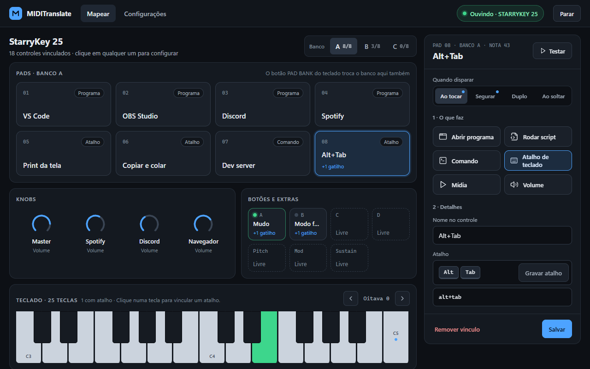
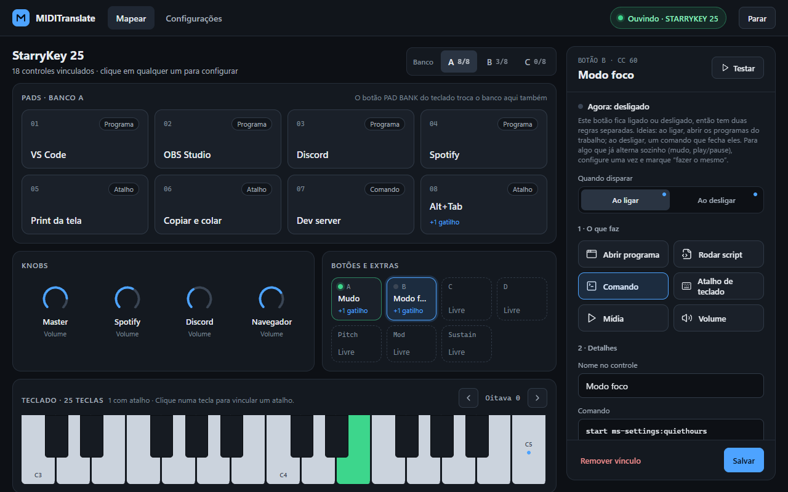
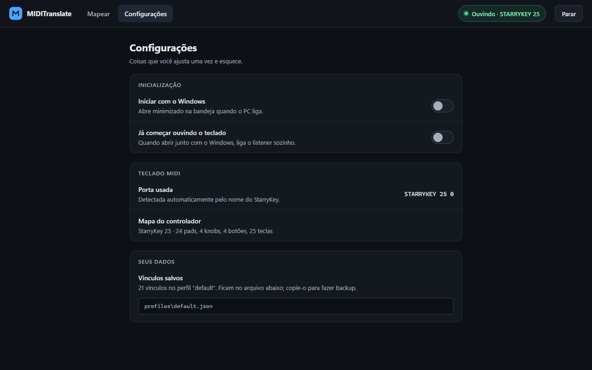

<div align="center">

# MIDITranslate

**Transforme um teclado MIDI num painel de atalhos para o Windows.**

Cada pad, knob, botão ou tecla pode abrir programas, rodar scripts e comandos,<br>
disparar atalhos de teclado e controlar mídia e volume — com um clique para configurar.




</div>

## Recursos

- **Mapa visual do controlador** — pads, knobs, botões e piano desenhados como no aparelho, mostrando o que cada um faz.
- **Seis tipos de ação** — abrir programa, rodar script (`.vbs`, `.ps1`, `.bat`, `.py`), comando, atalho de teclado ou sequência (macro), mídia (play/pause, próxima, anterior) e volume — geral ou de um programa específico.
- **Escolha o programa sem caçar caminho** — lista dos programas abertos agora e busca entre os instalados no menu Iniciar. Apps da Microsoft Store usam um identificador estável, que não quebra quando o app atualiza.
- **Quatro gatilhos por pad** — ao tocar, segurar, toque duplo e ao soltar; cada um com sua própria ação.
- **Botões liga/desliga** — os botões A–D ficam ligados ou desligados, então têm duas regras: *ao ligar* e *ao desligar*. Para ações que já alternam sozinhas (mudo, play/pause), uma opção aplica a mesma ação nos dois.
- **Tudo ao vivo** — pads acendem ao tocar, knobs mostram o nível, e a tela acompanha o banco de pads e a oitava do teclado.
- **Vale na hora** — salvar um vínculo reinicia o listener automaticamente.
- **Sempre pronto** — inicia com o Windows, minimizado na bandeja, já ouvindo o teclado.

## Compatibilidade

| | |
|---|---|
| **Sistema** | Windows 10 e 11. Linux e macOS **não são suportados** nesta versão: o backend usa APIs do Windows (volume por programa, janelas, menu Iniciar). |
| **Controlador** | Donner **StarryKey 25** (layout incluso, porta detectada pelo nome). Outros controladores ainda não têm layout. |

## Instalação

> Ainda não há instalador para download — o executável é compilado na sua máquina, em poucos minutos.

**Pré-requisitos**

- [Python 3.10+](https://www.python.org/downloads/) — o instalador do python.org inclui o comando `py`, que o app usa.
- [Node.js 18+](https://nodejs.org/) e [Rust](https://rustup.rs/) — só para compilar.
- WebView2 — já vem no Windows 11 (no Windows 10, [instale aqui](https://developer.microsoft.com/microsoft-edge/webview2/)).

**Passos**

```powershell
git clone https://github.com/Will-Ch4ps/MIDI-Translator.git
cd MIDI-Translator
py -3 -m pip install -r requirements.txt
npm --prefix frontend ci
npm run tauri:build -- --no-bundle
```

O app fica em `src-tauri\target\release\miditranslate.exe`. Para abrir junto com o Windows, ligue **Configurações → Iniciar com o Windows**.

> [!IMPORTANT]
> O executável usa os arquivos Python da pasta onde foi compilado. Não mova nem apague a pasta do projeto depois de compilar — se precisar mover, compile de novo.

## Como usar

1. Conecte o StarryKey e clique em **Ouvir teclado**.
2. Clique no pad, knob, botão ou tecla que quer configurar.
3. Escolha **quando disparar** e **o que faz**, preencha os detalhes e clique em **Salvar**. Já vale.

**Dicas**

- **Testar** executa a ação na hora, sem precisar do teclado.
- No atalho de teclado, clique em **Gravar atalho** e aperte as teclas. Vários atalhos separados por vírgula (`ctrl+c, ctrl+v`) viram uma sequência.
- No volume, `master` é o volume geral do Windows; para um programa, use o nome do processo (`spotify.exe`, `discord.exe`).
- Para vincular teclas de outra oitava, use as setas acima do piano — ou simplesmente toque a tecla: a tela acompanha.



## Seus dados

- Os vínculos ficam em `profiles/default.json`. Esse arquivo **não vai para o git** — para fazer backup, copie-o.
- A preferência "já começar ouvindo o teclado" fica guardada no próprio app.



## Desenvolvimento

```powershell
npm --prefix frontend run dev        # UI no navegador (http://127.0.0.1:5173) usando o Python real
npm run tauri:dev                    # app completo em modo de desenvolvimento
npm --prefix frontend run typecheck  # checagem de tipos
```

- No navegador, o Vite encaminha as chamadas para o mesmo `backend/bridge.py` que o app usa. Listener, autostart e "Procurar…" ficam desativados (são do Rust). **Testar executa a ação de verdade.**
- Para não mexer nos seus vínculos, aponte para uma cópia dos dados (com `backend/`, `core/`, `devices/`, `config/` e `profiles/`):
  ```powershell
  $env:MIDI_ROOT = "C:\caminho\da\copia"; npm --prefix frontend run dev
  ```
- Para simular o teclado no navegador, use o console: `window.__midi({ type: "control", control_id: "PAD_A1", value: 100, pressed: true })`.

## Arquitetura

```
frontend/   React + Vite — interface (Mapear, Configurações)
src-tauri/  Rust + Tauri — janela, bandeja, autostart e processo do listener
backend/    Python — bridge.py (comandos da interface) e service.py (listener MIDI)
core/       Python — layout do aparelho, perfis, roteamento e execução das ações
devices/    layout do controlador (starrykey25.json)
profiles/   seus vínculos — fora do git
tools/      midi_probe.py, para inspecionar mensagens MIDI cruas
```

```
Interface (React) ─invoke─▶ Rust ─▶ py backend/bridge.py <comando> <json>     uma chamada por ação da interface
                             └───▶ py backend/service.py                       listener MIDI, sempre rodando
                                     └─ eventos JSON por linha ─▶ "midi-runtime" ─▶ Interface (feedback ao vivo)
```

## Roadmap

- [ ] Instalador para download, independente da pasta do projeto
- [ ] Python embutido (sem pré-requisitos para quem só quer usar)
- [ ] Vários perfis pela interface
- [ ] Suporte a outros controladores MIDI
- [ ] Linux

## Histórico

As mudanças de cada versão estão no [CHANGELOG](CHANGELOG.md). A versão 0.2 ("MIDI Studio", com conectores para OBS, Spotify, Discord e outros) foi arquivada na tag [`v0.2-studio-archive`](../../tree/v0.2-studio-archive).
